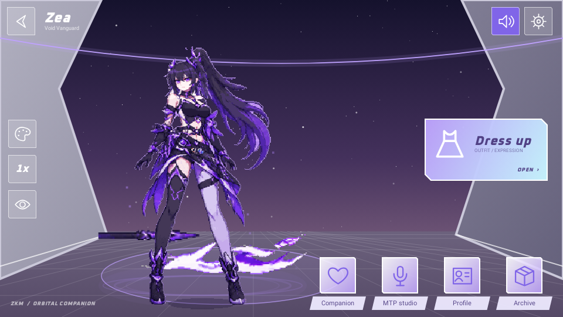
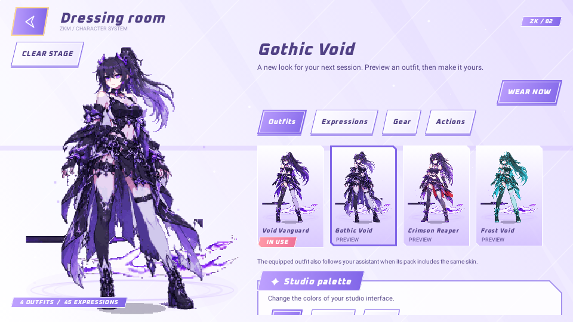
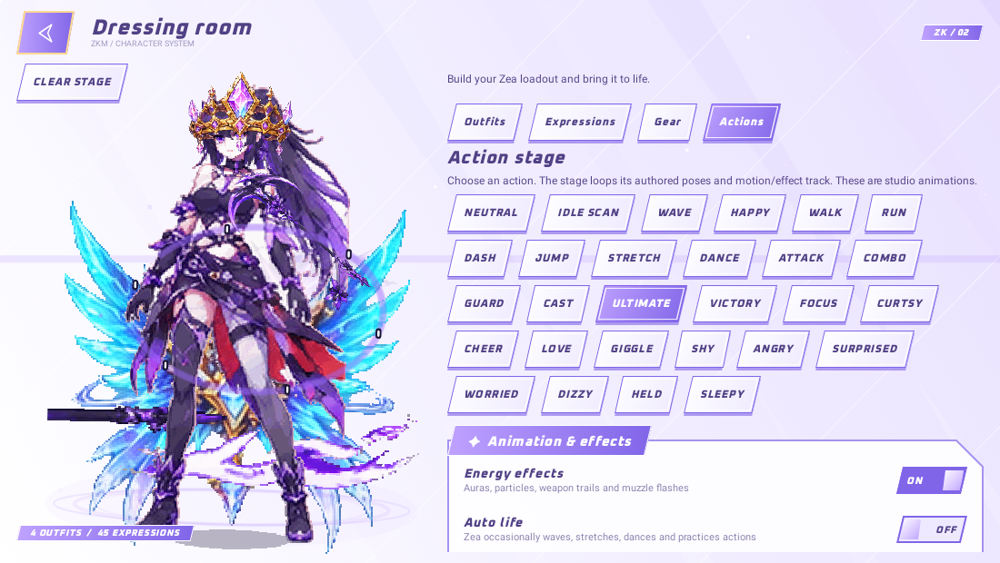

# ZKMNEXT GameSpace

**Your games. Your controls. Your space.**

One Android app for your game library, in-game overlays, input plugins and device monitoring.
Set it up once, then play the way you want. Made by **zuanvfx02**.

[**Download**](https://github.com/zuanvfx02/zkmnext-gamespace/releases/latest) ·
[Releases & changelogs](https://github.com/zuanvfx02/zkmnext-gamespace/releases) ·
[Documentation](docs/README.md) ·
[Report an issue](https://github.com/zuanvfx02/zkmnext-gamespace/issues)

> [!NOTE]
> What a device can control depends on its Android version, ROM, chipset, kernel, sensors, permissions and the access backend you choose. GameSpace does not promise higher FPS, lower temperatures or compatibility with every game.

## Contents

- [Meet ZEA](#meet-zea)
- [ZEA previews](#zea-previews)
- [Why GameSpace](#why-gamespace)
- [What's new in 1.5.0](#whats-new-in-150)
- [Features](#features)
- [Requirements and access modes](#requirements-and-access-modes)
- [Install and update](#install-and-update)
- [Troubleshooting](#troubleshooting)
- [Privacy and security](#privacy-and-security)
- [License](#license)
- [How it works](#how-it-works)
- [Community](#community)
- [Feedback and support](#feedback-and-support)

## Meet ZEA

**ZEA is the official anime character and companion of ZKMNEXT GameSpace.**
A familiar face for your gaming space: meet her Void form in the Character Room, or her Mini form as your on-screen companion.

<table>
<tr><td align="center" width="50%"> <b>ZEA Void</b> Void Vanguard · Character Room</td><td align="center" width="50%"> <b>ZEA Mini</b> Your on-screen companion</td></tr>
</table>

- **Four outfits:** Void Vanguard, Gothic Void, Crimson Reaper and Frost Void.
- **Expressions and actions:** explore reactions, poses and authored action animations.
- **Equipment:** personalize her loadout in the Character Studio.
- **One identity:** full and Mini are two forms of ZEA, GameSpace's own character.

Character packs are imported separately in the app. See the [character pack guide](docs/character-packs.md) and [ZEA Void](docs/zea-void.md).

## ZEA previews

These previews show the actual Android Character Studio with ZEA Void.

| Character Room | Dressing room | Action stage |
| --- | --- | --- |
|  |  |  |

[Open the GameSpace website](https://zkmnext-gamespace-docs-expressive-v43f.classicecho1.chatgpt.site) · [Preview refresh details](docs/void-preview-refresh.md)

## Why GameSpace

- **Every game gets its own setup.** Per-game profiles, covers and backgrounds, so each title feels like it belongs in your library.
- **Controls stay in reach.** Floating panels, notes and tools open on top of the game, so you never have to leave it.
- **Your inputs, your rules.** Keymap, Shoulder Triggers, Gravity X and Macro can run side by side without fighting each other.
- **Straight about its limits.** Each feature is checked per device, and the app tells you what your hardware and access mode can actually do.

## What's new in 1.5.0

GameSpace now only runs when you need it, and you decide which apps it may close.

| | |
| --- | --- |
| **App Templates** | A whitelist for apps GameSpace must never close (VPN, ping booster) and a blacklist for apps it closes when a game starts. Keep several templates, share them as `.json`, import with a preview, and back up or restore your setup. Find it in Super Base. |
| **Super Base for Gamepad** | Gamepad mode gets its own console-style Super Base with big tiles and D-pad focus: App Templates, FPS Results, Album, Plugins and more. |
| **Runs only when needed** | With Shizuku, Axeron or Root, backend mode is on by default. A tiny watcher detects your games and starts GameSpace; the app itself no longer sits in the background. Switching apps keeps the session while the game is alive; closing the game ends it and GameSpace stops shortly after. Force stop really stops it. |
| **Smoother game start** | Fixed the start animation (Energy Cube v2/v3) freezing on one frame. Hunt Mode does less work per frame. |
| **New intros** | Handheld's tunnel now flies toward you and the logo settles in gently. Gamepad opens with the new Wave animation. |
| **Proprietary license** | GameSpace is closed source. Leftover GPL notices from early development were removed. See [License](#license). |

Full notes for every version are on the [Releases](https://github.com/zuanvfx02/zkmnext-gamespace/releases) page.

## Features

<table>
<tr>
<td width="50%" valign="top">

### Game library
- Add installed games and launch them from a dedicated library.
- Per-game profiles instead of one global setting.
- Custom covers, backgrounds and profile appearance.
- GameSpace Center and Super Base for tools and settings.
- **App Templates**: whitelist apps GameSpace must never close and blacklist apps to close at game start. Share, import, back up and restore them as JSON.

</td>
<td width="50%" valign="top">

### Interface modes
- **Explore**: an everyday dashboard and settings.
- **Handheld**: a landscape, console-inspired lobby.
- **Gamepad**: controller-first navigation, with its own console-style Super Base.
- Themes, colors, wallpaper and effects. Blur needs Android 12+ and device support.

</td>
</tr>
<tr>
<td valign="top">

### In-game overlays
- **Energy Cube** and **Compact** panels for quick controls and monitoring.
- Notes (text and images), game controls and plugins without leaving the game.
- Needs the *display over other apps* permission.

</td>
<td valign="top">

### Monitoring and device controls
- CPU, GPU, RAM, temperature, battery, network and FPS where supported.
- Performance profiles, per-game configuration and Thermal Advance.
- Advanced CPU/GPU, charging, kernel, fan and display options depend on what the device exposes. Root alone does not create hardware support.

</td>
</tr>
<tr>
<td valign="top">

### Plugins and input tools
- **Gravity X**: keyboard, mouse and gamepad mapping schemes.
- **Keymap** and **Shoulder Triggers**: button-to-touch controls.
- **Macro**: record and replay, with speed control and floating buttons.
- **Gyro Manipulation**, **Scout**, **MTP**, **Free to Display**, crosshair, stopwatch and more.

</td>
<td valign="top">

### Tools and media
- **Task Manager**: process view, end eligible user apps, App Freezer. System apps are protected.
- **GameSpace Album**: screenshots and recordings grouped by game, with filters and sharing.
- Music controls with media-session integration.
- Local backup, restore and diagnostics.

</td>
</tr>
</table>

Each plugin's availability is checked separately. Android or a game may restrict input injection and automation, so check the game's rules before using mapping or macro tools.

## Requirements and access modes

**Minimum:** Android 10 (API 29). Some features need a newer version.

| Mode | What it enables |
| --- | --- |
| **Basic** | Library, interface, profiles and other features that need no privileged access. Normal Android permissions still apply. |
| **Shizuku** | Shell-level operations while Shizuku (or Shizuku Next / Shevery) is running and access is granted. |
| **Axeron** | Privileged-shell operations through the configured Axeron backend. |
| **Root** | System and kernel controls when root is available and the device exposes the required interfaces. |

With Shizuku, Axeron or Root, **backend mode** is on by default: a small background watcher (like the daemons of Magisk or KernelSU) starts GameSpace when one of your games opens, and GameSpace stops again after the game closes. With Root the watcher also starts at boot; with Shizuku or Axeron it needs the service to be running. Turn it off in Game Space Center › Other options (Handheld) or Settings › Other (Gamepad). In Basic mode GameSpace keeps its always-on game detection.

<b>Permissions and why they are requested</b>

| Permission / access | Used for |
| --- | --- |
| Display over other apps | Floating panels and tools |
| Usage access | Foreground-game detection and playtime |
| Notifications | Service status, optional features and update alerts |
| Photos/videos or selected documents | Album and imported media |
| Screen capture consent / microphone | Recording and optional recording audio |
| Notification access / Do Not Disturb access | Optional notification and focus tools |
| Accessibility (magnification only) | Scout zoom. It cannot read your screen. |

Grant only what the features you use need. Android and ROM restrictions can still limit behavior after a permission is granted.

## Install and update

1. Open [GitHub Releases](https://github.com/zuanvfx02/zkmnext-gamespace/releases).
2. Download the **`.apk` under Assets**. The "Source code (zip / tar.gz)" entries GitHub adds to every release only contain this documentation. They are not the app and cannot be installed.
3. Install it, allowing your browser or file manager to install apps if Android asks.
4. Add a game, choose an interface mode and grant the optional permissions you need.

That's it. You're ready to play.

<b>How update checks work</b>

- The app checks stable GitHub Releases when it opens, and schedules a network-constrained background check about every six hours. Android decides the exact timing; force-stop, battery restrictions or no connection can delay it.
- A newer release shows an update dialog with release notes. Background notifications need notification permission and the App updates channel. "Later" snoozes that release for 24 hours.
- Downloads and installs are always user-confirmed. The app opens the APK link in a browser and never installs silently.
- A new tag must compare higher than the installed version. Replacing the APK under the same tag does not count as an update.
- To install over an existing copy, keep the same package name and signing key and raise `versionCode`. Back up your keystore. A differently signed APK may need an uninstall first, which can remove local data.

## Troubleshooting

| Problem | What to check |
| --- | --- |
| No update shown | A stable, non-draft release with a higher version tag and a directly attached `.apk`. Connectivity and GitHub rate limits. Checks are cached for six hours. |
| No update notification | Notification permission and the App updates channel. The in-app dialog works without it. |
| Install/update rejected | Signing key, `versionCode`, Android compatibility and whether the download finished. |
| Overlay missing | Overlay permission, game detection and the ROM's background/battery restrictions. |
| GameSpace doesn't start with a game | The game is in your library, Shizuku/Axeron is running (needed again after a reboot) and backend mode's status in Other options. Turning backend mode off brings back always-on detection. |
| Sensor, FPS or control missing | Run the compatibility checks and verify access. Universal monitoring is not guaranteed. |
| Black screen or force-close | Open an issue with the version, device/ROM, access mode, steps and available diagnostics. |

## Privacy and security

Settings and media are handled locally by the features that use them, and Android's media/document permissions control access to external files. The updater contacts GitHub only for public release metadata and notes. Opening links, downloads or external viewers involves those services and apps.

> [!WARNING]
> Never post private keys, keystores, passwords, tokens or personal diagnostics in an issue. Review diagnostic exports before sharing, and report security problems through the repository's security-reporting route instead of a public issue.

## License

**ZKMNEXT GameSpace is proprietary, closed-source software. Copyright (c) 2025-2026 ZKMNEXT (zuanvfx02). All rights reserved.**

- This repository holds APK releases, release notes, documentation and the issue tracker. It does **not** contain the app's source code, and the source code is not available under any license.
- GameSpace is **not** open source and is **not** licensed under the GPL. Leftover GPL notices from early development were removed in version 1.5.0; from 1.5.0 on, every release is proprietary.
- You may install and use the official APK on your own devices. Copying, modifying, decompiling, repackaging, reselling, rebranding or re-uploading GameSpace or its assets (including the ZEA character) is not allowed without written permission.
- Only download GameSpace from this repository's [Releases](https://github.com/zuanvfx02/zkmnext-gamespace/releases) or the official Telegram channel.
- GameSpace uses open-source libraries that keep their own licenses. See [`THIRD-PARTY-NOTICES.md`](THIRD-PARTY-NOTICES.md).

> The older app **Zuan Kernel Manager Next** is a separate project with its own open-source license. That license does not extend to GameSpace.

Full terms: [`LICENSE`](LICENSE).

## How it works

Curious what happens behind the scenes? The docs site has an interactive 3D map at `docs/index.html#cara-kerja`. Drag it to rotate, tap any node to read what it does, or play one of seven flows:

| Flow | What you see |
| --- | --- |
| Game launched | ActivityManager event → ProcessPulse → AIDL → game detection → overlay and profile → node journal → kernel |
| Press Keymap | Your finger → Keymap lease → shared touch session → `IRootService` → privileged process → Android input → game |
| Keymap + Macro | Two leases in one session, two separate finger lanes, one gesture |
| Gravity X | Gamepad stick → Gravity X → shared touch session → game |
| Rise mode | Panel → mode engine → journal saves the originals → privileged write to the kernel |
| App force-stopped | ScoutGuard hands a restore script to the privileged process, which runs it when the app dies |
| Screen off | ScreenGate pauses overlays and FPS sampling |

The map is a simplified picture of the app, and the animation simplifies timing.

## Community

Come hang out, share your setup, and catch updates early.

| | |
| --- | --- |
| Official channel | [t.me/ZUANVFXPROJECT3](https://t.me/ZUANVFXPROJECT3) |
| Pre-release news | [t.me/ZuanvfxArch](https://t.me/ZuanvfxArch) |
| Discussion | [t.me/zuanvfx01project3chat](https://t.me/zuanvfx01project3chat) |
| Kernel Manager Next group | [t.me/zuankernelmanagernextgroup](https://t.me/zuankernelmanagernextgroup) |
| Donate | [sociabuzz.com/zuanvfx01/tribe](https://sociabuzz.com/zuanvfx01/tribe) |

## Feedback and support

When you report a problem, please include:

- App version and Android version
- Device model, ROM, chipset and access backend
- Steps to reproduce, what you expected and what happened
- Screenshots or sanitized diagnostics when they help

Share your setup and suggest improvements in the [discussion group](https://t.me/zuanvfx01project3chat). Community: **ZUANVFX**.

Maintained by <b>zuanvfx02</b> · ZKMNEXT

